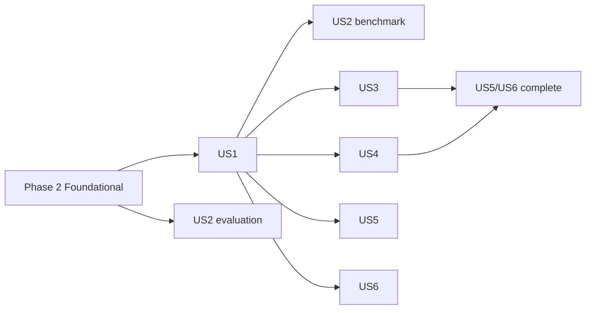

---

description: "Task list for 001 MIDI score following"
---

# Tasks: MIDI Score Following (pthmm, hmm, outerhmm)

**Input**: Design documents from `/specs/001-midi-score-following/`

**Prerequisites**: [plan.md](plan.md), [spec.md](spec.md), [research.md](research.md), [data-model.md](data-model.md), [contracts/](contracts/), [quickstart.md](quickstart.md)

**Tests**: Required. FR-015 and constitution I demand golden tests per processor and method; they are listed before the implementation they verify and must fail first.

**Organization**: Grouped by user story (spec priorities: US1 P1, US2 P1, US3 P2, US4 P2, US5 P3, US6 P3).

## Format: `[ID] [P?] [Story] Description`

- **[P]**: Can run in parallel (different files, no dependency on an incomplete task)
- **[Story]**: User story the task belongs to (US1 … US6)
- Every module that ports Python names the ported Python path in its module doc (II); every public item is documented and every public module has a runnable doc example (II); per-frame `tracing` spans use `DEBUG`/`TRACE` (III); no `unsafe`, no panics on user input (IV)

## Path Conventions

Cargo workspace per [plan.md](plan.md#source-code-repository-root): core crate at repo root (`src/`, `tests/`), `crates/matchmaker-cli/`, `crates/matchmaker-py/`, tooling in `tools/`.

---

## Phase 1: Setup (Shared Infrastructure)

**Purpose**: Workspace, dependencies, CI gates, reference assets and the locked reference environment

- [X] T001 Convert `Cargo.toml` into workspace + root package: `[workspace] members = [".", "crates/matchmaker-cli", "crates/matchmaker-py"]`, `default-members = [".", "crates/matchmaker-cli"]`, shared `[workspace.package]` (edition 2024, `rust-version = "1.85"`, license, repository) and `[workspace.lints]` (`missing_docs = "warn"`, `unsafe_code = "deny"`, `clippy::undocumented_unsafe_blocks = "deny"`); core deps `midly`, `musicxml`, `ndarray` (default-features off, `std`), `npyz` (feature `derive`), `realfft`, `thiserror`, `tracing`, `serde` (derive), `serde_json` in `Cargo.toml`
- [X] T002 [P] Create CLI crate skeleton `crates/matchmaker-cli/Cargo.toml` (bin `matchmaker`, deps `matchmaker-rs` path, `clap` derive, `anyhow`, `tracing-subscriber` env-filter) and `crates/matchmaker-cli/src/main.rs` with empty `follow`/`evaluate`/`bench` subcommands per [contracts/cli.md](contracts/cli.md)
- [X] T003 [P] Create Python crate skeleton `crates/matchmaker-py/Cargo.toml` (`crate-type = ["cdylib"]`, `pyo3` with `abi3-py310` + `extension-module`, `numpy`), `crates/matchmaker-py/pyproject.toml` (maturin, module `matchmaker_rs`, `requires-python = ">=3.10,<3.14"`) and empty `crates/matchmaker-py/src/lib.rs`
- [X] T004 [P] Add `"Unlicense"` (midly) to the allow list in `deny.toml` with a comment referencing research R12
- [X] T005 [P] Update `.github/workflows/ci.yml`: test/clippy with `--workspace --exclude matchmaker-py --all-features`, wasm job `cargo build -p matchmaker-rs --target wasm32-unknown-unknown`, MSRV job `cargo check -p matchmaker-rs -p matchmaker-cli --all-targets`, new `bindings` job (setup-python 3.10 and 3.13, `maturin develop`, `pytest crates/matchmaker-py/tests`)
- [X] T006 [P] Copy reference assets (`simple_mozart_k265_var1`, `mozart_k265_var1`, `Bach-fugue_bwv_858`: `.musicxml`, `.mid`, `.match`) from `../pymatchmaker-ref/matchmaker/assets/` (tag `v0.4.0`) into `tests/data/` and extend `NOTICE` with their Apache-2.0 attribution
- [X] T007 Create locked reference environment `tools/golden/pyproject.toml` (deps: `pymatchmaker` from git tag `v0.4.0`, numpy, scipy, partitura, mido; Python 3.12) and generate `tools/golden/uv.lock` with `python -m uv lock`; add a "Golden data" section to `README.md` with the regeneration command from [contracts/golden-data.md](contracts/golden-data.md)

---

## Phase 2: Foundational (Blocking Prerequisites)

**Purpose**: Golden data, error type, score loading, performance loading, stream, processors, follower trait — needed by every story

**⚠️ CRITICAL**: No user story work can begin until this phase is complete

### Golden data and test helpers

- [X] T008 Write `tools/golden/generate.py`. First print a fixture coverage check per score (repeat barlines, voltas, segno/coda/da capo, grace notes, ties, multiple parts, multiple voices, pickup measure, time-signature changes); for every feature that no bundled piece contains, add a minimal MusicXML fixture `tests/data/fixture_<feature>.musicxml` (score-only golden: `score/` files) so that FR-002 and US1-3 are covered. Then for each piece in `tests/data/` load the score exactly like `Matchmaker.__init__` (load_musicxml `ignore_invisible_objects=True, force_note_ids="keep"` / load_score, `unfold_part_maximal(ignore_leaps=False)`, `merge_parts`, fallback without unfolding) and write `score/note_array.npy` + `score/meta.json`; write `stream/{event,windowed_0.01,windowed_0.001}/messages.npy` + `frame_times.npy` via `midi_messages_from_performance` / `midi_messages_to_framed_midi`; write `processor/{pitch_piano_vector,pitch_piano_list,pitch_full_vector,chord_onset_piano}/features.npy` + `times.npy` (pitch lists padded with -1), with `pitch_*` from `windowed_0.01` and additionally `pitch_piano_vector_event` from `event`, and `chord_onset_piano` from `windowed_0.001`; layout and dtypes exactly as [contracts/golden-data.md](contracts/golden-data.md)
- [X] T009 Extend `tools/golden/generate.py` with method runs for `pthmm`, `hmm`, `outerhmm` built through `matchmaker.Matchmaker(..., input_type="midi", method=m)`: record per yielded step `positions`, `current_index`, `probabilities` (`forward_variable` / `state_probabilities`, skip if K·N > 5e6), `beat_period` (hmm), `is_continuation` (outerhmm), the follower's observations (`observations_features.npy`, `observations_times.npy`), `score_positions.npy`, `alignment_path.npy`, `evaluation.json` (`resolve_gt(.match, mm.score_part.note_array(), performance)` + `evaluate_alignment`) and `meta.json` with reference tag, lockfile SHA-256, config and tolerances; also a MIDI-score run (`simple_mozart_k265_var1.mid` as score) under `tests/golden/simple_mozart_k265_var1_midiscore/pthmm/`
- [X] T010 Run `python -m uv run generate.py` in `tools/golden/` and commit the output under `tests/golden/`
- [X] T011 [P] Implement golden test helpers in `tests/common/mod.rs`: `load_npy::<T>(path)` (own `npy` module), `load_note_array` (structured), `assert_exact`, `assert_close(rtol|abs)` that panic with method, piece, file, first differing index, expected and actual (SC-007), and `golden_dir(piece, sub)`

### Core types

- [X] T012 [P] Implement `Error` in `src/error.rs` with variants `Io { path, source }`, `UnsupportedFormat { path, extension }`, `MusicXml { path, message }`, `Midi { path, message }`, `InvalidScore { path, reason }`, `InvalidMethod { input_type, method, available }`, `InvalidParameter { method, key, allowed }`, `GroundTruth { path, reason }`, `Export { path, source }` (thiserror) and `pub type Result<T>`; wire modules in `src/lib.rs`

### Score loading (partitura subset, R6/R7)

- [X] T013 [P] Write failing golden test `tests/golden_score.rs`: for every piece compare `Score::load` notes with `score/note_array.npy` (ids, `pitch`, `voice`, `onset_div`, `duration_div` exact; `onset_beat`, `duration_beat`, `onset_quarter`, `duration_quarter` exact as `f32`), tempo with `score/meta.json`, plus the MIDI-score variant
- [X] T014 [P] Implement `ScoreNote`, `Score`, `Score::load(path, unfold: bool)` (extension dispatch: `.musicxml`/`.xml`/`.mxl` → MusicXML, `.mid`/`.midi` → MIDI score, else `Error::UnsupportedFormat`), `unique_onsets() -> Vec<f32>` and `chords() -> Vec<BTreeSet<u8>>` in `src/score/mod.rs`; validation per [data-model.md](data-model.md#scorenote--one-row-of-partituras-note_array): "`pitch ≤ 127`; `duration_div ≥ 0`; ids unique after unfolding (error otherwise)"; notes stable-sorted by `onset_beat` then `pitch`
- [X] T015 [P] Port `Part._time_interpolator` (beat map / quarter map incl. anacrusis correction `y -= actual_dur`, keypoints from divisions and time signatures, `musical_beat` off) in `src/score/timeline.rs` with unit tests for 4/4, 6/8, 3/8 and a pickup measure
- [X] T016 Port `partitura.io.importmusicxml.load_musicxml` subset in `src/score/musicxml.rs` on top of `roxmltree` (+ `zip` for `.mxl`): divisions, backup/forward, chord, grace (included, onset of anchor position), cue and `print-object="no"`/notehead `none` skipped (`ignore_invisible_objects=True`), ties (first note of chain, duration over the chain), voice/staff, time and key signatures, repeats/endings/segno/coda/fine/da capo/dal segno (barline and `<sound>`), `<sound tempo>` and `<metronome>` → tempo, note ids with `force_note_ids="keep"`; `.mxl` via the crate; errors as `Error::MusicXml` (depends on T014, T015)
- [X] T017 Port `get_paths(all_repeats=True, ignore_leap_info=False)` and `unfold_part_maximal(update_ids=True)` (ids suffixed `-<repetition>`) in `src/score/unfold.rs`; on failure fall back to the non-unfolded part like the reference (depends on T016)
- [X] T018 Port `merge_parts` (lcm of divisions, time rescaling, first-part tempos/time signatures only, voice reassignment) in `src/score/merge.rs` (depends on T016)
- [X] T019 [P] Port `partitura.io.importmidi.load_score_midi` (default `part_voice_assign_mode=0`, no quantization, divs = ppq, time signatures, tempo objects) in `src/score/midi.rs` (depends on T014, T015)
- [X] T020 [P] Port `get_tempo_from_score` (partitura `Tempo` → `to_quarter_tempo(unit or "q", bpm)`, first `<sound tempo>`, `TEMPO_MARKING_TO_BPM` text markings with simple/compound meter adjustment) and `to_quarter_tempo` in `src/score/tempo.rs` with unit tests (depends on T014)
- [X] T021 Make `tests/golden_score.rs` pass for all pieces (iterate on T015–T020)

### Performance and stream (R5)

- [X] T022 [P] Write failing golden test `tests/golden_stream_processors.rs` (stream part): messages per mode equal `stream/<mode>/messages.npy` (times exact, compared as multiset per timestamp), `frame_times.npy` exact
- [X] T023 [P] Port `load_performance_midi` (per-track `(channel, pitch)` pairing, overwrite on re-trigger, ignore unmatched note-offs, tempo changes collected across tracks, sort `(note_on, pitch, note_off, channel, track)`, times recomputed with `adjust_time`; note ids are added with the `.match` ground truth in T043) and `midi_messages_from_performance` (note-on + note-off per note, then control and program changes, **stable** sort by time) with `PerformedNote`, `Performance::load` in `src/performance.rs`, using `midly`
- [X] T024 [P] Implement `MidiMessage`, `MidiMessageKind`, `Frame`, `StreamMode { Event, Windowed { polling_period } }` and `frames(messages, mode)` porting `midi_messages_to_framed_midi` exactly (`n = ceil(max_t/pp)`, frame 0 takes `t ≤ pp`, frame k takes `k·pp < t ≤ (k+1)·pp`, time `(k+0.5)·pp`) in `src/io/stream.rs`; `TRACE` span `stream` per frame

### Processors (FR-006, SC-003)

- [X] T025 [P] Extend `tests/golden_stream_processors.rs` (processor part, failing first): features and times of `pitch` (vector/list, piano/full) and `chord_onset` equal `processor/*/features.npy` / `times.npy` exactly for all pieces
- [X] T026 [P] Implement `Processor` trait (`process`, `flush_remaining` default `None`, `reset`), `Observation { features, perf_time }`, `Features { PitchVector(Vec<f32>), PitchList(Vec<f32>) }` in `src/features/mod.rs`
- [X] T027 [P] Port `PitchProcessor` (`piano_range`, `return_pitch_list`; observation time = min note-on time in frame; `None` without note-on; velocity-0 note-on ignored) in `src/features/pitch.rs`; `DEBUG` span `feature`
- [X] T028 [P] Port `ChordOnsetProcessor` (`chord_threshold = 0.035`, flush on gap `> threshold`, empty-frame heartbeat, `flush_remaining`) in `src/features/chord_onset.rs`; `DEBUG` span `feature`
- [X] T029 Make `tests/golden_stream_processors.rs` pass

### Follower base

- [X] T030 Implement `OnlineAlignment` trait (`step`, `call` default = set perf time, step, push `(perf_time, position)`; `is_still_following` default `current_index < n_states − 1`; `current_position` = `score_positions[current_index] as f64`; `debug_state() -> StepDebug`), `AlignmentPath { perf_time, score_beat }` and the default run loop in `src/base.rs`; `DEBUG` span `inference` with fields `index`, `perf_time`, `position`

**Checkpoint**: Score, performance, stream and processors match the reference; user stories can start

---

## Phase 3: User Story 1 - Follow a recorded MIDI performance with `pthmm` (Priority: P1) 🎯 MVP

**Goal**: `pthmm` produces reference-equal positions and alignment path via library and CLI

**Independent Test**: `cargo run -p matchmaker-cli -- follow tests/data/simple_mozart_k265_var1.musicxml tests/data/simple_mozart_k265_var1.mid --output path.tsv` prints positions; `cargo test --test golden_pthmm` passes

### Tests for User Story 1 ⚠️

- [X] T031 [P] [US1] Write failing golden test `tests/golden_pthmm.rs`: (a) follower fed with `pthmm/observations_*.npy` reproduces `score_positions.npy` (exact `f32`), `positions.npy` and `alignment_path.npy` (< 1e-6, SC-001), `current_index.npy` exact, `probabilities.npy` (rtol 1e-12); (b) end to end via `Matchmaker` for all pieces and the MIDI-score variant (US1-2)
- [X] T032 [P] [US1] Write failing CLI test `crates/matchmaker-cli/tests/follow.rs`: `follow` prints `<perf_time>\t<beat>` lines, `--output path.tsv` (header `perf_sec\tscore_beat`) and `--output path.npy` (2×T) equal the golden path; unknown `--method` exits 1 listing `pthmm, hmm, outerhmm`

### Implementation for User Story 1

- [X] T033 [P] [US1] Port `hiddenmarkov.forward_algorithm_step` (`prior = init` on first step else `Tᵀ·fv`; `fv = obs·prior`; `fv /= max(sum, 1e-6)`; argmax first max) and `ConstantTransitionModel` with `BandedTransitionMatrix { rows: Vec<(start, Vec<f64>)> }` storing only non-zero entries in `src/prob/hidden_markov.rs`, with a unit test that the banded product equals a dense product on random rows
- [X] T034 [P] [US1] Port in `src/prob/hmm_models.rs`: `gumbel_l_pdf(x, loc, scale) = exp(z − exp(z))/scale`, `stable_transition_matrix(n, mp_trans_state = 1, scale, inserted_states)` (loc `i+2` even / `i+1` odd, row-normalised, banded), `init_dist(n, loc = 0, scale = 10)` (`scale if scale < n else n/10`, not normalised), `compute_chord_matrix`, `compute_discrete_pitch_profiles` (direct "same" convolution with `[0.02, 0.02, 1, 0.02, 0.02]`, interleave + drop last, `+0.01`, slice `21..109`, row-normalise), Bernoulli probabilities (product of selected factors), inserted-state positions in `f32` (`o + 0.5·diff`); unit tests against values from `tests/golden/*/pthmm/` 
- [X] T035 [US1] Port `PitchHMM` as `PitchHmm` + `PitchHmmConfig { has_insertions = true, piano_range = true }` in `src/prob/pthmm.rs` (depends on T033, T034)
- [X] T036 [US1] Implement `Method { Pthmm, Hmm, OuterHmm }` (`FromStr` → `Error::InvalidMethod` listing available), `ProcessorKind`, `MethodConfig` (overrides; unknown keys → `Error::InvalidParameter`), per-method defaults (pthmm/hmm `Windowed(0.01)`, outerhmm `Windowed(0.001)`, processor flags per research R1) and `Matchmaker::{new, run, alignment_path, score, tempo, score_positions, build_score_annotations, follower}` with tempo precedence user > score > 120 BPM in `src/matchmaker.rs` (Hmm/OuterHmm return `Error::InvalidMethod` until US3/US4)
- [X] T037 [US1] Implement incremental push mode `Matchmaker::{push(msg, time_s), finish()}` (windows close on later message or `finish`; non-decreasing timestamps else `Error::InvalidParameter`) in `src/matchmaker.rs` and `src/io/stream.rs` (FR-005) with a unit test that push mode equals file mode on `simple_mozart_k265_var1`
- [X] T038 [US1] Implement CLI `follow` (args per [contracts/cli.md](contracts/cli.md): `--method`, `--processor`, `--tempo`, `--no-unfold`, `--set KEY=VALUE`, `--output .tsv|.npy`, `--quiet`; `RUST_LOG` via `tracing-subscriber` env filter; exit codes 0/1/2) in `crates/matchmaker-cli/src/main.rs`
- [X] T039 [US1] Make `tests/golden_pthmm.rs` and `crates/matchmaker-cli/tests/follow.rs` pass; if an argmax flips, report the step and add a NumPy-compatible pairwise sum in `src/prob/hidden_markov.rs` (research R4)

**Checkpoint**: MVP — `pthmm` works from library and CLI with reference parity

---

## Phase 4: User Story 2 - Prove parity and compare performance (Priority: P1)

**Goal**: Reference evaluation metrics and a Rust-vs-Python benchmark report published from CI

**Independent Test**: `cargo test --test golden_eval` passes; quickstart §7 produces `report/index.md` with both implementations side by side

### Tests for User Story 2 ⚠️

- [X] T040 [P] [US2] Write failing golden test `tests/golden_eval.rs`: `evaluate_alignment` on each golden `alignment_path.npy` + `.match` GT equals `evaluation.json` (abs 1e-4); unit tests for `transfer_positions` (last entry per perf time, step-hold, NaN before first), 4-decimal rounding on halfway cases, `skew`/`kurtosis` (bias=True, Fisher) and SPARC on a fixed trajectory
- [X] T041 [P] [US2] Write failing CLI test `crates/matchmaker-cli/tests/evaluate.rs`: `evaluate --json` prints exactly the keys `mean_b, median_b, std_b, accuracy_0.05b, accuracy_0.1b, accuracy_0.3b, accuracy_0.5b, accuracy_1b, accuracy_2b, skewness, kurtosis, smoothness`

### Implementation for User Story 2

- [X] T042 [P] [US2] Port `transfer_positions` (domain `score` and `performance`), `get_evaluation_results`, `evaluate_beat_errors`, `onset_wise_windows`, `spectral_arc_length` (rfft via `realfft`, `n_fft = 2^(ceil(log2 n)+4)`), `compute_sparc` (50 Hz hold resampling, `np.gradient` edge_order 1) and `evaluate_alignment` → `EvaluationResult` (serde keys as reference) in `src/utils/eval.rs`
- [X] T043 [US2] Implement `GroundTruth::load` in `src/utils/eval.rs`: TSV (header columns `perf_sec`, `score_beat`) and `.match` (parse `snote`/`note`/alignment lines; join on shared score ids, perf onsets from streamed MIDI when ids and pitches agree; drop consecutive equal beats after stable sort by time); unsupported fallback join → `Error::GroundTruth` naming `tools/golden/match_to_tsv.py` (research R8)
- [X] T044 [P] [US2] Write `tools/golden/match_to_tsv.py` converting a `.match` to TSV with the reference's `resolve_gt`
- [X] T045 [US2] Implement CLI `evaluate` (table or `--json`, `--performance`) in `crates/matchmaker-cli/src/main.rs`
- [X] T046 [US2] Implement CLI `bench` in `crates/matchmaker-cli/src/bench.rs`: TOML manifest (`dataset`, `piece`, `score`, `performance`, `ground_truth`), `--runs` (default 5), `--methods`; time processor and follower calls per observation with `std::time::Instant`, no tracing subscriber; write records per [contracts/benchmark-report.md](contracts/benchmark-report.md) with `implementation = "rust"`, plus the alignment path of run 0 as `<out_dir>/paths/<dataset>/<piece>/<method>.npy` (2×T) for position parity (SC-001); methods default to the ones enabled in `Method` so the command works before US3/US4
- [X] T047 [P] [US2] Write `tools/bench/bundled.toml` (the three bundled pieces) and `tools/bench/run_reference.py` (uses `tools/golden` environment; wraps reference processor `__call__` and follower `__call__` with `time.perf_counter()` without modifying the reference; same record schema, `implementation = "python"`; also writes the alignment path per piece and method like T046)
- [X] T048 [P] [US2] Write `tools/bench/report.py`: merge Rust and Python records, medians over runs, speed-up, real-time factor, metrics, parity flags: metric parity (golden tolerances) and position parity per piece and method from the written paths (SC-001: all positions < 1e-6 for `pthmm`/`outerhmm`; SC-002: ≥ 99.9 % for `hmm`), naming the first differing step (SC-007); job fails on a position-parity violation; regression flag (> 1.10 × latest master report), cache marker; output `report.json`, `index.md`, `index.html`
- [X] T049 [P] [US2] Verify that the licenses of (n)ASAP, Batik and Vienna4x22 allow automated download and evaluation in CI (ask the maintainer to confirm before enabling the CI job), then write `tools/datasets/datasets.toml` (pinned URL, commit/version, SHA-256 and license note per dataset) and `tools/datasets/fetch.py` (download, verify, extract, emit bench manifests `tools/bench/<dataset>.toml`); record sources in `README.md`
  - Done as: git shallow fetch at the pinned commit (the commit hash verifies the content, no SHA-256 of archives); manifests are written next to the data (`<dest>/<dataset>.toml`, absolute paths); `--limit` takes an even, deterministic subset. Maintainer approved CI download (data never uploaded). `.match` GT gained the reference's fallback join on (pitch, onset beat) for files without shared note ids (Vienna 4x22, onset beat = snote `OnsetInBeats`) and legacy match versions 3.0-5.0 ((n)ASAP); verified locally: metric and position parity on 4 Batik, 4 Vienna 4x22 and 2 (n)ASAP pieces.
- [X] T050 [US2] Write `.github/workflows/benchmark.yml`: on push to `master` and PRs touching `src/**`; fetch datasets (cache), shard per dataset, run `matchmaker bench --runs 5` and `run_reference.py` (reference accuracy cached by key tag+lockfile+dataset SHA, latency re-measured), `report.py` with the previous master report, publish to GitHub Pages, upload artifact
  - Done as: `PIECES_PER_DATASET=10` per dataset shard, Python re-run with `--runs 3` each time (no reference-accuracy cache yet); `METHODS=pthmm` until US3/US4 land; Pages deploy only from `master`.
- [X] T051 [US2] Make `tests/golden_eval.rs`, `crates/matchmaker-cli/tests/evaluate.rs` pass and run quickstart §4 and §7 locally on the bundled pieces

**Checkpoint**: Parity is proven by tests and the benchmark report exists

---

## Phase 5: User Story 3 - Follow with tempo-aware `hmm` (Priority: P2)

**Goal**: `hmm` (PitchIOIHMM + Kalman) with reference parity and inspectable beat period

**Independent Test**: `cargo test --test golden_hmm` passes; `follow --method hmm --export out` writes `beat_period.npy`

### Tests for User Story 3 ⚠️

- [ ] T052 [P] [US3] Write failing golden test `tests/golden_hmm.rs`: replayed observations and end to end; positions equal in ≥ 99.9 % of steps and evaluation within 0.01 (SC-002), `beat_period.npy` rtol 1e-9, `probabilities.npy` rtol 1e-12; report first differing step

### Implementation for User Story 3

- [ ] T053 [P] [US3] Port `KalmanTempoModel` (`init_beat_period`, `init_score_onset`, `trans_par = 1`, `trans_var = 0.03`, `obs_var = 0.0213`, `init_var = 1`; first update only initialises) in `src/utils/tempo_models.rs`, mirroring per-operand precision from research R4 (`score_ioi`/gain in `f32`, `performed_ioi` in `f64`, `beat_period` Python-float then `f64`) with a comment naming the Python expression on each mixed-precision line
- [ ] T054 [P] [US3] Add ACC pitch-IOI observation model to `src/prob/hmm_models.rs`: pitch list → binary vector (pitches outside 0..88 dropped, documented deviation), IOI term `sqrt(1/2π)·exp(−0.5·(beat_period·|s_cur − s_j| − ioi_obs)²)` with the IOI row computed on the fly in `f64` (research R3)
- [ ] T055 [US3] Port `PitchIOIHMM` as `PitchIoiHmm` + `PitchIoiHmmConfig` (defaults per [data-model.md](data-model.md#follower-state-per-method)) in `src/prob/hmm.rs`: `ioi_obs` from previous observation time (0 first), tempo update only when `state > prev_index` and (no insertions or even state), `StepDebug.beat_period` (depends on T053, T054)
- [ ] T056 [US3] Enable `Method::Hmm` in `src/matchmaker.rs` (processor `pitch` with `return_pitch_list = true`) and make `tests/golden_hmm.rs` pass

**Checkpoint**: `hmm` works independently of `outerhmm`

---

## Phase 6: User Story 4 - Follow note by note with `outerhmm` (Priority: P2)

**Goal**: `outerhmm` with chord folding, skips and patience stop, equal to the reference

**Independent Test**: `cargo test --test golden_outerhmm` passes

### Tests for User Story 4 ⚠️

- [ ] T057 [P] [US4] Write failing golden test `tests/golden_outerhmm.rs`: replayed observations and end to end; `positions`, `current_index`, `is_continuation`, `alignment_path` (< 1e-6) and `probabilities` (rtol 1e-12) for all pieces; plus a wrong-note case (one performed pitch shifted by a semitone, golden produced by `tools/golden/generate.py` variant `simple_mozart_k265_var1_wrongnote`) (US4-2)

### Implementation for User Story 4

- [X] T058 [US4] Add the wrong-note variant to `tools/golden/generate.py` (shift the 5th note-on by +1 semitone in memory before streaming) and regenerate `tests/golden/simple_mozart_k265_var1_wrongnote/`
- [ ] T059 [P] [US4] Port in `src/prob/outerhmm.rs`: `compute_OuterProductHMM_pitch_probabilities` (classes correct 0.9497, semitone 0.0145/2, whole tone 0.0224/2, octave 0.0047/2, within octave 0.0086/9/2, `other_prob = 1e-6`, divided by class sizes), `compute_transition_matrix` (1e-6 fill, deltas −3..3 with `DEFAULT_TRANSITIONS`, `+ f64::EPSILON`, row-normalise), `log_b = ln(max(b[:, 21..109], 1e-300))` precomputed
- [ ] T060 [US4] Port `OuterProductHMM` as `OuterProductHmm` + config (`transitions`, `pitch_error_probs`, `S`, `r` default `1/N`, `other_prob`, `patience = 10`, `ioi_threshold = 0.035`) in `src/prob/outerhmm.rs`: Viterbi step (band `[i−3, i+3]` vs `r_i·max(S·p)`, `>=` tie rule, normalise or uniform), chord folding from `pre_chord_probs` without path entry, `is_still_following` always true, patience counter skipping continuations, `StepDebug.is_continuation` (depends on T059)
- [ ] T061 [US4] Enable `Method::OuterHmm` in `src/matchmaker.rs` (stream `Windowed(0.001)`, processor `pitch` vector) and make `tests/golden_outerhmm.rs` pass

**Checkpoint**: All three methods work and match the reference

---

## Phase 7: User Story 5 - Use the Rust follower from Python (Priority: P3)

**Goal**: `from matchmaker_rs import Matchmaker` is a drop-in for pymatchmaker's MIDI usage

**Independent Test**: `pytest crates/matchmaker-py/tests` passes after `maturin develop`

### Tests for User Story 5 ⚠️

- [ ] T062 [P] [US5] Write failing `crates/matchmaker-py/tests/test_drop_in.py`: README quickstart pattern for `pthmm`, `hmm`, `outerhmm` yields floats; `score_follower.alignment_path` is `float64` `(2, T)` equal to `tests/golden/<piece>/<method>/alignment_path.npy`; `mm.score_positions` = unique onsets; `method="arzt"` and `input_type="audio"` raise `ValueError` listing `['pthmm', 'hmm', 'outerhmm']`; non-MIDI performance raises the reference message

### Implementation for User Story 5

- [ ] T063 [US5] Implement `Matchmaker` pyclass in `crates/matchmaker-py/src/lib.rs` with the reference signature (`score_file, performance_file=None, input_type="audio", method=None, *, stream=None, processor=None, device_name_or_index=None, tempo=None, wait=False, unfold_score=True, kwargs=None`), `kwargs` mapping to `MethodConfig`, error mapping per [contracts/python-api.md](contracts/python-api.md#errors)
- [ ] T064 [US5] Implement `run(verbose=True)` as a Python generator (yield positions, return alignment path), `score_follower` object (`alignment_path` ndarray, `_alignment_path` list, `score_positions` float32), `tempo`, `method`, `input_type`, `config`, `polling_period`, `score_positions`, `build_score_annotations`, `export`, module constants `AVAILABLE_METHODS`, `DEFAULT_KWARGS`, `__version__`, `__reference_version__` in `crates/matchmaker-py/src/lib.rs`
- [ ] T065 [US5] Make `crates/matchmaker-py/tests/test_drop_in.py` pass on Python 3.10 and 3.13

**Checkpoint**: Python users can switch with one import change

---

## Phase 8: User Story 6 - Debug a disagreement (Priority: P3)

**Goal**: Rust exports intermediate data in the golden layout; a script finds the first differing stage

**Independent Test**: `follow --export out/...` then `tools/golden/compare.py` reports "all stages equal" for a golden piece and the first difference after a deliberate change

### Tests for User Story 6 ⚠️

- [ ] T066 [P] [US6] Write failing test `tests/export.rs`: `export::write_run` for each method writes every file listed in [contracts/golden-data.md](contracts/golden-data.md) with the documented dtypes/shapes, readable back with the test `.npy` reader, and equal to the golden files within tolerance

### Implementation for User Story 6

- [ ] T067 [US6] Implement `export::write_run(&Matchmaker, dir)` in `src/export.rs` (score, stream, processor, method files; `meta.json` with `{"implementation": "matchmaker-rs", "version"}`; `Error::Export` on failure), collecting `StepDebug` per step in `Matchmaker`
- [ ] T068 [US6] Add `--export <DIR>` to CLI `follow` and `export(directory)` to the Python binding (`crates/matchmaker-cli/src/main.rs`, `crates/matchmaker-py/src/lib.rs`)
- [ ] T069 [P] [US6] Write `tools/golden/compare.py <golden_dir> <export_dir>`: compare stages in order score → stream → processor → method with the documented tolerances, print the first differing stage, file and index or "all stages equal"
- [ ] T070 [US6] Verify US6-2: with `RUST_LOG=matchmaker_rs=debug` the CLI logs per-stage span timings (`tracing-subscriber` `FmtSpan::CLOSE`) and the current position per observation; add an assertion test in `crates/matchmaker-cli/tests/logging.rs`

**Checkpoint**: All user stories independently functional

---

## Phase 9: Polish & Cross-Cutting Concerns

- [ ] T071 [P] Edge-case tests in `tests/edge_cases.rs`: empty performance / no note-ons → empty path, no error; `hmm` with a pitch outside 21–108 ignores it (documented deviation, research R3); performance longer than score → positions within score; velocity-0 note-on treated as note-off; score without tempo → 120 BPM; corrupt/unsupported score and performance files → typed errors naming the file; no panics (US1 edge cases in [spec.md](spec.md#edge-cases))
- [ ] T072 [P] Doc examples: one runnable example per public module (`score`, `performance`, `io::stream`, `features::*`, `prob::*`, `utils::*`, `export`, `matchmaker`) and crate-level docs in `src/lib.rs`; `cargo test --doc` passes
- [ ] T073 [P] Verify `cargo build -p matchmaker-rs --target wasm32-unknown-unknown`, `cargo deny check`, MSRV `cargo +1.88 check`; fix any dependency feature that pulls `std::time`/C code into the core
- [ ] T074 [P] Update `README.md`: quickstart (3 commands, SC-005), methods/processors table, benchmark report link and badge (SC-006), Python install, golden-data regeneration, dataset sources
- [ ] T075 Run all [quickstart.md](quickstart.md) scenarios and fix deviations
- [ ] T076 Compare SC-004 in the first benchmark report; if Rust inference is < 5× faster, profile `pthmm` on the largest piece and record the result in `specs/001-midi-score-following/research.md` (R2 note)

---

## Dependencies & Execution Order

### Phase Dependencies

- **Setup (Phase 1)**: none
- **Foundational (Phase 2)**: after Setup; T008–T010 need T006/T007; T013–T021 need T012; T022–T029 need T012, T023 before T024 tests pass; T030 after T026. Blocks all stories
- **US1 (Phase 3)**: after Foundational
- **US2 (Phase 4)**: after Foundational; benchmark tasks T046–T050 need US1's `Matchmaker` (T036); evaluation (T040–T045) is independent of US1
- **US3 (Phase 5)**: after US1 tasks T033–T036 (shared HMM modules and facade)
- **US4 (Phase 6)**: after Foundational + T036 (facade); independent of US3
- **US5 (Phase 7)**: after T036; covers whichever methods are enabled (full test after US3, US4)
- **US6 (Phase 8)**: after T036; method-specific files need US3/US4 for `beat_period` / `is_continuation`
- **Polish (Phase 9)**: after the desired stories

### User Story Dependencies



### Within Each User Story

- Golden/CLI tests first and failing, then building blocks, then follower, then facade/CLI wiring, then make tests pass
- Every story checkpoint also runs `cargo test --doc` and `cargo clippy --workspace --exclude matchmaker-py --all-targets` (doc example per public module, constitution II)
- Commit after each task or logical group

## Parallel Opportunities

- Phase 1: T002–T006 in parallel after T001
- Phase 2: T011, T012 in parallel; score track (T013–T021) parallel to performance/stream/processor track (T022–T029); T015, T019, T020 parallel
- US1: T031, T032, T033, T034 in parallel
- US2: T040, T041, T042, T044, T047, T048, T049 in parallel
- US3 and US4 in parallel after US1 (different files: `src/prob/hmm.rs`, `src/utils/tempo_models.rs` vs `src/prob/outerhmm.rs`)

### Parallel Example: User Story 1

```text
Task: "T031 Write failing golden test tests/golden_pthmm.rs"
Task: "T032 Write failing CLI test crates/matchmaker-cli/tests/follow.rs"
Task: "T033 Port forward_algorithm_step + banded transitions in src/prob/hidden_markov.rs"
Task: "T034 Port HMM builders in src/prob/hmm_models.rs"
```

### Parallel Example: User Story 2

```text
Task: "T040 Write failing golden test tests/golden_eval.rs"
Task: "T042 Port evaluation in src/utils/eval.rs"
Task: "T047 Write tools/bench/run_reference.py"
Task: "T049 Write tools/datasets/datasets.toml and fetch.py"
```

---

## Implementation Strategy

### MVP First (User Story 1)

1. Phase 1 Setup → Phase 2 Foundational (golden data first, then score loading — the riskiest part)
2. Phase 3 US1 → **STOP and VALIDATE**: `golden_pthmm` green, quickstart §1

### Incremental Delivery

1. US1 (`pthmm`) → MVP
2. US2 (evaluation + benchmark) → parity and speed visible in CI
3. US3 (`hmm`) and US4 (`outerhmm`) → all methods
4. US5 (Python) and US6 (debug export) → interfaces complete
5. Polish → quickstart validated, README final

## Notes

- [P] tasks = different files, no dependency on incomplete tasks
- Never push without asking (repository rule); commit locally per task group
- Any deviation from the reference found while implementing goes into `research.md` and, if it affects results, into the test's documented tolerance (constitution I)
