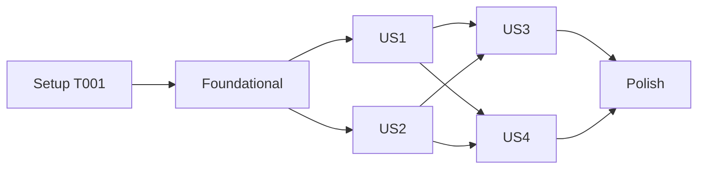

---

description: "Task list for 002 MIDI online time warping"
---

# Tasks: MIDI Online Time Warping (arzt, dixon)

**Input**: Design documents from `/specs/002-midi-oltw/`

**Prerequisites**: [plan.md](plan.md), [spec.md](spec.md), [research.md](research.md), [data-model.md](data-model.md), [contracts/interfaces.md](contracts/interfaces.md), [quickstart.md](quickstart.md)

**Tests**: Required. FR-007 and constitution I demand golden tests per method; they are listed before the implementation they verify and must fail first.

**Organization**: Grouped by user story (spec priorities: US1 P1, US2 P1, US3 P1, US4 P2).

## Format: `[ID] [P?] [Story] Description`

- **[P]**: Can run in parallel (different files, no dependency on an incomplete task)
- **[Story]**: User story the task belongs to (US1 … US4)
- Every module that ports Python starts with `Port of <python symbol>` and an `Upstream: <file>` line ([UPSTREAM.md](../../UPSTREAM.md)); every public item is documented and every public module has a runnable doc example; per-call spans use `DEBUG`/`TRACE`; no `unsafe`, no panics on user input
- Mixed `float32`/`float64` lines name the Python expression in a comment (research R2)

## Path Conventions

Cargo workspace per [plan.md](plan.md#source-code-changes-to-the-001-layout): core crate at the repo root (`src/`, `tests/`), `crates/matchmaker-cli/`, `crates/matchmaker-py/`, tooling in `tools/`. Toolchain and reference environment as in the [001 quickstart](../001-midi-score-following/quickstart.md).

---

## Phase 1: Setup

**Purpose**: Resolve the one open fact of the plan

- [X] T001 Probe SciPy in the golden environment with a throw-away script in `target/tmp/` (not committed): `cdist` with `float32` inputs for `cosine` and `euclidean`, including a zero row against a non-zero row and zero against zero; record the exact results (value or NaN, warnings) in `specs/002-midi-oltw/research.md` R4, replacing "measured, not assumed"

---

## Phase 2: Foundational (Blocking Prerequisites)

**Purpose**: Golden data, the onset pianoroll, the distance functions and the config fields both methods need

**⚠️ CRITICAL**: No user story work can begin until this phase is complete

- [X] T002 Extend `tools/golden/generate.py`: add `"arzt"` and `"dixon"` to `METHODS` (the existing loops already cover the `_midiscore` and `_wrongnote` variants; the reference followers expose neither `forward_variable` nor `state_probabilities`, so `probabilities.npy` must not be written, check `dump_method`) and, in `dump_score`, write `score/onset_pianoroll.npy` (`piano_range=True`), `score/onset_pianoroll_full.npy` (`piano_range=False`) and `score/onset_positions.npy` from `matchmaker.features.midi.onset_pianoroll(note_array, "onset_beat", piano_range)`; layout per [contracts/interfaces.md](contracts/interfaces.md#golden-data)
- [X] T003 Run `python -m uv run generate.py --data ../../tests/data --out ../../tests/golden` in `tools/golden/` and commit only additions: `git status` must show new files under `tests/golden/**/{arzt,dixon}/` and `tests/golden/*/score/onset_*`; restore every modified existing file with `git checkout -- <file>` (regenerated 001 probabilities differ by ~1e-15 and stay as committed)
- [X] T004 [P] Extend `tools/golden/compare.py`: add `"arzt"`, `"dixon"` to `METHODS` (so `STAGES` compares them) and mention them in the docstring
- [X] T005 [P] Extend `tests/golden_score.rs` (failing first): `Score::onset_pianoroll(true)` and `(false)` rows equal `score/onset_pianoroll.npy` / `onset_pianoroll_full.npy` and positions equal `onset_positions.npy`, exact, for all pieces and the MIDI-score variant
- [X] T006 Implement `Score::onset_pianoroll(&self, piano_range: bool) -> (Vec<Vec<f32>>, Vec<f32>)` in `src/score/mod.rs`: rows over `unique_onsets()`; "`1.0` at `pitch − offset` for every note starting there; `D/offset` = 88/21 (`piano_range`) or 128/0; out-of-range pitches ignored"; doc example; make T005 pass
- [X] T007 [P] Create `src/dp/mod.rs` (`Port of matchmaker.dp` / `Upstream: matchmaker/dp/direction.py`, `matchmaker/dp/oltw_arzt.py`) with `Direction { Ref, Input, Both }` and `Distance { Cosine, Euclidean }` (`FromStr` → `Error::InvalidParameter` listing both names; `Distance::between(&[f32], &[f32]) -> f64` computed in `f64` like `cdist`, zero-vector behaviour as measured in T001) plus unit tests (known values, identical vectors, zero vector); add `pub mod dp;` to `src/lib.rs`
- [X] T008 [P] Add to `MethodConfig` in `src/matchmaker.rs`: `step_size`, `window_size`, `max_run_count: Option<usize>` and `distance_func: Option<Distance>`, handled in `MethodConfig::set` ("sizes ≥ 1", otherwise `Error::InvalidParameter` naming the key); which keys a method accepts stays in `Method::config_keys` (extended by T012, T017)

**Checkpoint**: Golden data, onset pianoroll and distances ready; user stories can start

---

## Phase 3: User Story 1 - Follow a MIDI performance with `arzt` (Priority: P1) 🎯 MVP

**Goal**: `arzt` produces reference-equal positions and alignment path via library and facade

**Independent Test**: `cargo test --test golden_arzt` passes

### Tests for User Story 1 ⚠️

- [X] T009 [P] [US1] Write failing golden test `tests/golden_arzt.rs` after `tests/golden_outerhmm.rs`: (a) `ArztEvent` fed with `arzt/observations_*.npy` reproduces `score_positions.npy` (exact `f32`), `positions.npy` and `alignment_path.npy` (< 1e-6, SC-001) and `current_index.npy` (exact); (b) end to end via `Matchmaker` for all pieces, the MIDI-score and the wrong-note variants; mismatches name method, piece, file and first differing index (SC-004)
- [X] T010 [P] [US1] Extend `tests/method_config.rs` (failing first): `MethodConfig::for_method(Method::Arzt)` is `chord_onset`, `piano_range`, `polling_period = Some(0.001)`; `set(Arzt, "step_size", Int(3))` works, `Int(0)` is `InvalidParameter`; `window_size` and `start_window_size` are `InvalidParameter` ("not used by the reference's MIDI arzt"); `distance_func` `"euclidean"` works and `"manhattan"` lists `cosine`, `euclidean`; an unknown key lists the allowed keys

### Implementation for User Story 1

- [X] T011 [US1] Port `OnlineTimeWarpingArztEvent` as `ArztEvent` + `ArztEventConfig { window_size: 30, start_window_size: 5, step_size: 5, distance: Cosine }` in `src/dp/oltw_arzt.rs` (`pub mod oltw_arzt;` in `src/dp/mod.rs`) per [research R2](research.md#r2-arzt-event-algorithm-and-dtypes): window `[max(current_index − step_size, 0), min(start + w, N))` with `w = start_window_size` while `input_index < start_window_size`, `Vec<[f32; 2]>` cost matrix (every `best` rounded to `f32` on store, `norm` from the unrounded `f64`), Python `min`/strict `<` comparisons (not `f64::min`), first-cell special case, column shift, `clip(min_index, current_index, current_index + step_size)` after the first input; `OnlineAlignment` with `is_still_following = current_index < N − 1`, empty `StepDebug.probabilities`, `DEBUG` span `inference`; unit test on a hand-made 3-onset reference
- [X] T012 [US1] Enable `Method::Arzt` in `src/matchmaker.rs`: `AVAILABLE` and its array length, `name`, `FromStr`, `config_keys` (`processor`, `piano_range`, `polling_period`, `step_size`, `distance_func`), `MethodConfig::for_method` (`ProcessorKind::ChordOnset`, `polling_period = Some(0.001)`), follower built from `score.onset_pianoroll(config.piano_range)` and the config in `Matchmaker::with_config`; add the `Method::Arzt` arm to the `match` in `src/export.rs` (no extra file); depends on T006–T008, T011
- [X] T013 [US1] Make `tests/golden_arzt.rs` and the T010 additions pass; on a position mismatch report the first step and check the `f32` storage and the `min` semantics of R2 before touching any tolerance

**Checkpoint**: MVP — `arzt` works from the library with reference parity

---

## Phase 4: User Story 2 - Follow a MIDI performance with `dixon` (Priority: P1)

**Goal**: `dixon` produces reference-equal positions and alignment path

**Independent Test**: `cargo test --test golden_dixon` passes

### Tests for User Story 2 ⚠️

- [X] T014 [P] [US2] Write failing golden test `tests/golden_dixon.rs`, same checks as T009 for `dixon`
- [X] T015 [P] [US2] Extend `tests/method_config.rs` (failing first): `for_method(Method::Dixon)` is `chord_onset`, `piano_range`, `Some(0.001)`; `window_size` and `max_run_count` accept values ≥ 1 and reject 0; `distance_func` as in T010; `step_size` is `InvalidParameter`

### Implementation for User Story 2

- [X] T016 [US2] Port `OnlineTimeWarpingDixonEvent` as `DixonEvent` + `DixonEventConfig { window_size: 30, max_run_count: 3, distance: Euclidean }` in `src/dp/oltw_dixon.rs` (`pub mod oltw_dixon;` in `src/dp/mod.rs`) per [research R3](research.md#r3-dixon-event-algorithm-and-dtypes): `HashMap<(usize, usize), f64>` cost, `inputs`, `pending` (at most one), `t`, `j` (`isize`, −1 before the first input), run counts, `_evaluate` (weights 1, 1, 2, finite predecessors only, strict `<`), `_norm_cost = D / (1 + i + k)`, `_argmin_path_cost` (row scan, then column scan, initial `(inf, j, t)`), `get_inc` in the reference's order, the `while True` step loop with two `get_inc` calls per round, `current_index = min(argmin_ref, N − 1)`; same trait, span and doc rules as T011; unit test on a hand-made reference
- [X] T017 [US2] Enable `Method::Dixon` in `src/matchmaker.rs` (`AVAILABLE` and its array length, `name`, `FromStr`, `config_keys`: `processor`, `piano_range`, `polling_period`, `window_size`, `max_run_count`, `distance_func`; defaults as T012) and add the `Method::Dixon` arm in `src/export.rs`; depends on T011, T012 (same files), T016
- [X] T018 [US2] Make `tests/golden_dixon.rs` and the T015 additions pass; no performance work here (T022)

**Checkpoint**: Both methods work and match the reference

---

## Phase 5: User Story 3 - Prove parity and compare performance (Priority: P1)

**Goal**: Evaluation metrics, position parity and latency of both methods in the benchmark report

**Independent Test**: `cargo test --test golden_eval` passes; the benchmark report lists `arzt` and `dixon` next to the other methods

### Tests for User Story 3 ⚠️

- [X] T019 [P] [US3] Extend `tests/golden_eval.rs` (failing first): `evaluate_alignment` on the `arzt` and `dixon` golden `alignment_path.npy` + `.match` GT equals `evaluation.json` (abs 1e-4)

### Implementation for User Story 3

- [X] T020 [P] [US3] Add `"arzt"`, `"dixon"` to `METHODS` in `tools/bench/run_reference.py`; set `METHODS: pthmm,hmm,outerhmm,arzt,dixon` in `.github/workflows/benchmark.yml`; hold both methods to the exact position rule (`< 1e-6` at every step, SC-001) next to `pthmm`/`outerhmm` in `tools/bench/report.py` and its docstring; `matchmaker bench` records the method's real processor (`chord_onset`) and writes no tie margins for followers without a state distribution
- [X] T021 [US3] Run Rust (`matchmaker bench tools/bench/bundled.toml --methods arzt,dixon`), `tools/bench/run_reference.py` and `tools/bench/report.py` on the bundled pieces and on a `fetch.py --limit` subset of Batik, Vienna 4x22 and (n)ASAP: check position parity (SC-001), metric parity and the speed-up (SC-003). A position difference: find the first step, name the cause (`cdist` rounding, `f32` cost matrix, tie), and if it cannot be removed record it in `research.md` as a deviation shown by the evaluation metrics (constitution I)
- [X] T022 [US3] Only if SC-003 fails for `dixon`: replace the `HashMap` by per-column band storage in `src/dp/oltw_dixon.rs` (same results, `tests/golden_dixon.rs` stays green), re-measure and record both numbers in `research.md` R3 (not needed: SC-003 holds, numbers in R3)

**Checkpoint**: Parity and speed-up of both methods are shown by tests and the report

---

## Phase 6: User Story 4 - Use them from CLI, Python and the debug export (Priority: P2)

**Goal**: Both methods selectable in the CLI and the Python package, parameters overridable, intermediate data exportable

**Independent Test**: `cargo test -p matchmaker-cli`, `cargo test --test export`, and `pytest crates/matchmaker-py/tests` after `maturin develop`

### Tests for User Story 4 ⚠️

- [ ] T023 [P] [US4] Extend `crates/matchmaker-cli/tests/follow.rs` (failing first): `--method arzt` and `--method dixon` print positions equal to the golden ones; `--set window_size=5` with `arzt` exits 1 naming the key; an unknown method lists `pthmm, hmm, outerhmm, arzt, dixon`
- [ ] T024 [P] [US4] Update `crates/matchmaker-py/tests/test_drop_in.py` (failing first): `METHODS` gets `arzt`, `dixon` (alignment path equals `tests/golden/<piece>/<method>/alignment_path.npy`); the `{"method": "arzt"}` case of the `ValueError` test becomes `{"method": "foo"}` and the message lists `['pthmm', 'hmm', 'outerhmm', 'arzt', 'dixon']`; `DEFAULT_KWARGS["midi"]["arzt"]` is the reference dict (`window_size: 2`, `start_window_size: 2` included); `kwargs` with `window_size` is accepted for `arzt` (ignored, positions unchanged) and for `dixon`
- [ ] T025 [P] [US4] Extend `tests/export.rs`: the method loop includes `arzt` and `dixon`; every file of [contracts/interfaces.md](contracts/interfaces.md#golden-data) is written, `probabilities.npy` is absent, and the files equal the golden ones within tolerance

### Implementation for User Story 4

- [ ] T026 [US4] In `src/export.rs` write `probabilities.npy` only when the steps report probabilities (today it writes a `(T, N)` array unconditionally, which would be wrong for followers with an empty `StepDebug.probabilities`)
- [ ] T027 [US4] CLI in `crates/matchmaker-cli/src/main.rs` and `bench.rs`: `--method`, the error listing and the `bench` default method list must come from `Method::AVAILABLE`; the `--set` help text names the new keys per method
- [ ] T028 [US4] Python binding in `crates/matchmaker-py/src/lib.rs`: `default_kwargs` per method (values of [contracts/interfaces.md](contracts/interfaces.md#python); `AVAILABLE_METHODS`, `DEFAULT_KWARGS` and the error message already follow `Method::AVAILABLE`); for `arzt` skip `window_size` and `start_window_size` when applying `kwargs` (the reference's pass-through exclusion) with a one-line comment. The fallback polling period for replaced `kwargs` stays 0.01 s (`POLLING_PERIOD`; only `event_based` methods fall back to `None`) and the fallback processor stays `pitch`, as in `Matchmaker.__init__`: `MethodConfig::for_method` must not replace them
- [ ] T029 [US4] Make T023–T025 pass on Python 3.10 and 3.13; update the 001 documents that call `arzt` unsupported: the error row in `specs/001-midi-score-following/contracts/python-api.md` and the Python scenario of `specs/001-midi-score-following/quickstart.md`

**Checkpoint**: Both methods are usable from CLI and Python, and exportable

---

## Phase 7: Polish & Cross-Cutting Concerns

- [ ] T030 [P] Edge cases in `tests/edge_cases.rs` for both methods (extend the existing method loops): empty performance → empty path, no error; score with one onset; window larger than the score; an observation with no active pitch (pins the T001 result); performance longer than the score → positions within the score; no panics
- [ ] T031 [P] Update `README.md` (methods table rows `arzt`, `dixon`; roadmap item 1 includes them, item 2 stays audio) and `UPSTREAM.md` (module map rows for `src/dp/mod.rs`, `src/dp/oltw_arzt.rs`, `src/dp/oltw_dixon.rs`, `onset_pianoroll` in `src/score/mod.rs` → `matchmaker/features/midi.py`; "Not ported" no longer lists `dp/` as a whole: only the frame-level classes, `dtw_loop.pyx` and `oltw_arzt_multi_fold.py`)
- [ ] T032 [P] Doc examples for `dp`, `ArztEvent`, `DixonEvent`, `Score::onset_pianoroll`; `cargo test --doc` passes
- [ ] T033 Gates: `cargo fmt`, `cargo clippy --workspace --exclude matchmaker-py --all-targets --all-features -- -D warnings`, `cargo test --workspace --exclude matchmaker-py --no-fail-fast`, `cargo deny check`, wasm32 build if the target is installed
- [ ] T034 Run all [quickstart.md](quickstart.md) scenarios and fix deviations

---

## Dependencies & Execution Order

### Phase Dependencies

- **Setup (Phase 1)**: none; T001 feeds T007 (zero-vector behaviour) and T030
- **Foundational (Phase 2)**: T002 → T003; T005 before T006; T007, T008, T004 independent. Blocks all stories
- **US1 (Phase 3)**: after Foundational
- **US2 (Phase 4)**: after Foundational; T017 edits the same files as T012, so it follows T012 (the test and port tasks T014–T016 are independent of US1)
- **US3 (Phase 5)**: after US1 and US2 (needs both methods in the bench)
- **US4 (Phase 6)**: after US1 and US2; independent of US3
- **Polish (Phase 7)**: after the desired stories

### User Story Dependencies



### Within Each User Story

- Golden/config tests first and failing, then the port, then the facade wiring, then make the tests pass
- Commit after each task or logical group

## Parallel Opportunities

- Phase 2: T004, T005, T007, T008 in parallel after T003/T002 as listed
- US1 and US2: T009, T010, T014, T015 and the two ports (T011, T016) in parallel; T012 before T017
- US3 and US4 in parallel after US1 and US2; inside US4 T023–T025 in parallel

### Parallel Example: User Stories 1 and 2

```text
Task: "T009 Write failing golden test tests/golden_arzt.rs"
Task: "T011 Port ArztEvent in src/dp/oltw_arzt.rs"
Task: "T014 Write failing golden test tests/golden_dixon.rs"
Task: "T016 Port DixonEvent in src/dp/oltw_dixon.rs"
```

## Implementation Strategy

1. Setup + Foundational: golden data and score side first (they are what the ports are checked against)
2. MVP = US1 (`arzt`), validated by `golden_arzt`
3. US2 (`dixon`) next; US3 proves parity and speed; US4 exposes both
4. Polish last; the 001 test suite must stay green throughout (SC-005)
