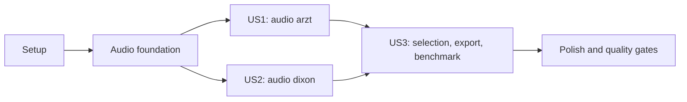

# Tasks: Audio Online Time Warping (arzt, dixon)

**Input**: Design documents from `/specs/003-audio-oltw/`

**Prerequisites**: [plan.md](plan.md), [spec.md](spec.md), [research.md](research.md), [data-model.md](data-model.md), [contracts/audio-api.md](contracts/audio-api.md), [quickstart.md](quickstart.md)

**Tests**: Golden, processor, interface, and edge-case tests are required by spec FR-006/FR-007 and Constitution I/IV.

**Organization**: Setup and shared audio infrastructure precede independently testable user stories. Each user story phase includes its own tests and implementation tasks.

## Format: `[ID] [P?] [Story] Description`

- **[P]**: Tasks touch different files and can proceed without an incomplete dependency.
- **[Story]**: User-story tasks are labeled `[US1]`, `[US2]`, or `[US3]`.
- Every task names the exact file path(s) it changes or validates.

## Phase 1: Setup

**Purpose**: Resolve asset provenance, add the selected pure-Rust dependencies, and prepare deterministic reference inputs.

- [X] T001 [P] Verify and pin the runtime SF2 SoundFont source, SHA-256, license, attribution, and provisioning instructions in `tests/data/audio/README.md`; do not bundle or download an unverified asset.
- [X] T002 [P] Add Symphonia 0.6.1, Rubato 5.0.1, and RustySynth 1.3.8 with only required features in `Cargo.toml`, allow MPL-2.0 with rationale in `deny.toml`, and verify license/build metadata in `.github/workflows/ci.yml`.
- [X] T003 Add the locked-reference audio fixture/golden generator in `tools/golden/generate_audio.py` and document fixture provenance and generated files in `tests/data/audio/README.md`.

## Phase 2: Foundational Audio Pipeline

**Purpose**: Build the shared audio types, file pipeline, processors, and synthesized score reference required by both followers.

**Blocking**: All tasks in this phase must complete before US1 and US2 implementation.

- [X] T004 Add typed audio decode/render/config errors and an audio-specific method/config model without changing MIDI defaults in `src/error.rs` and `src/matchmaker.rs`.
- [X] T005 [P] Write failing decoder and framing tests for WAV/FLAC/MP3/Ogg, mono downmixing, configured-rate conversion, cache priming, final-hop zero padding, empty files, corrupt files, and timestamps in `tests/audio_io.rs`.
- [X] T006 [P] Implement pure-Rust decode, mono conversion, resampling, hop framing, first-block priming, final-hop padding, and per-stage `DEBUG` spans in `src/io/audio.rs`; export the audio stream module from `src/io/mod.rs`.
- [X] T007 [P] Write failing feature goldens for `chroma` and `lse`, including all four method/processor configurations, frame counts, timestamps, state reset, and silence behavior in `tests/golden_audio_processors.rs`.
- [X] T008 [P] Implement the upstream chromagram and log-spectral-energy processors with reset behavior and frame-level tracing in `src/features/chroma.rs`, `src/features/lse.rs`, and `src/features/mod.rs`.
- [X] T009 [P] Write failing score-reference tests for rendering, onset padding, final 0.1-second tail, processor reset, and per-reference-frame beat mapping in `tests/score_audio.rs`.
- [X] T010 [P] Implement score-to-audio rendering with the configured SF2, processor feature generation, frame-to-beat mapping, and a `DEBUG` render span in `src/score/audio.rs`; expose the score-audio reference builder from `src/score/mod.rs`.
- [X] T011 Generate and check in deterministic audio fixture and reference outputs for both processors and score-reference stages using `tools/golden/generate_audio.py`, `tests/data/audio/`, and `tests/golden/audio/`.

**Checkpoint**: Audio input, features, score reference, and their goldens are available before either frame-level follower is wired.

## Phase 3: User Story 1 - Follow Recorded Audio with `arzt` (Priority: P1)

**Goal**: Deliver reference-aligned audio `arzt` through the core library, CLI, and Python facade.

**Independent Test**: Run the bundled score/audio fixture with audio `arzt`; replayed observations and both `chroma`/`lse` configurations match goldens, and the end-to-end alignment path matches within documented tolerances.

### Tests for User Story 1

- [X] T012 [P] [US1] Write failing replay and end-to-end golden tests for audio `arzt` with both `chroma` and `lse`, including first-differing-frame diagnostics, in `tests/golden_audio_arzt.rs`.
- [X] T013 [P] [US1] Write failing CLI tests for audio `arzt`, method defaults, output path, SoundFont errors, and invalid audio parameters in `crates/matchmaker-cli/tests/follow_audio.rs`.
- [X] T014 [P] [US1] Write failing Python facade tests for `input_type="audio"`, audio `arzt`, default kwargs, generator positions, alignment path shape, and typed errors in `crates/matchmaker-py/tests/test_audio.py`.

### Implementation for User Story 1

- [X] T015 [P] [US1] Port the frame-level `OnlineTimeWarpingArztFrame` recurrence, second-to-frame windows, step clamp, Manhattan distance default, beat mapping, and per-frame `DEBUG` inference span in `src/dp/arzt_frame.rs`.
- [X] T016 [US1] Wire audio `arzt` defaults/configuration and follower construction into the input-specific core API without changing MIDI `arzt` behavior in `src/matchmaker.rs`.
- [X] T017 [US1] Add audio input selection, `--soundfont-path`, processor/config options, path output, and clear file/config errors to `crates/matchmaker-cli/src/main.rs`.
- [X] T018 [US1] Add audio `arzt` construction, kwargs/default handling, yielded positions, and final alignment path to `crates/matchmaker-py/src/lib.rs`.

**Checkpoint**: Audio `arzt` is usable and independently comparable through Rust, CLI, and Python.

## Phase 4: User Story 2 - Follow Recorded Audio with `dixon` (Priority: P1)

**Goal**: Deliver reference-aligned audio `dixon` through the same user-facing surfaces.

**Independent Test**: Run the bundled score/audio fixture with audio `dixon`; replayed observations and both `chroma`/`lse` configurations match goldens, and the end-to-end alignment path stays within the score and matches the reference tolerance.

### Tests for User Story 2

- [ ] T019 [P] [US2] Write failing replay and end-to-end golden tests for audio `dixon` with both `chroma` and `lse`, including first-differing-frame diagnostics and short-score cases, in `tests/golden_audio_dixon.rs`.
- [ ] T020 [P] [US2] Write failing CLI tests for audio `dixon`, its LSE/50-fps defaults, output path, and invalid audio parameters in `crates/matchmaker-cli/tests/follow_audio.rs`.
- [ ] T021 [P] [US2] Extend Python facade tests for audio `dixon`, its defaults, processor override, yielded positions, and final alignment path in `crates/matchmaker-py/tests/test_audio.py`.

### Implementation for User Story 2

- [ ] T022 [P] [US2] Port the frame-level `OnlineTimeWarpingDixonFrame` sparse cost search, second-to-frame window, run-count limits, Euclidean distance default, beat mapping, and per-frame `DEBUG` inference span in `src/dp/dixon_frame.rs`.
- [ ] T023 [US2] Wire audio `dixon` defaults/configuration and follower construction into the input-specific core API without changing MIDI `dixon` behavior in `src/matchmaker.rs`.
- [ ] T024 [US2] Add audio `dixon` CLI dispatch and method-specific help/defaults in `crates/matchmaker-cli/src/main.rs`.
- [ ] T025 [US2] Add audio `dixon` Python defaults and construction while preserving MIDI `dixon` kwargs in `crates/matchmaker-py/src/lib.rs`.

**Checkpoint**: Both frame-level followers are independently usable and match their replay goldens.

## Phase 5: User Story 3 - Choose Audio Features and Inspect a Run (Priority: P2)

**Goal**: Let users select compatible processors and inspect/export audio pipeline stages and benchmark evidence.

**Independent Test**: Run each supported processor through a completed audio follower; verify overrides, typed invalid-option errors, and NumPy-readable exports of audio frames, performance features, score reference, beat mapping, per-frame positions, and alignment path.

### Tests for User Story 3

- [ ] T026 [P] [US3] Write failing tests for audio processor overrides, invalid method/processor combinations, and complete stage exports in `tests/audio_config_export.rs` and `tests/export.rs`.
- [ ] T027 [P] [US3] Add failing audio benchmark smoke tests for records, real-time factor, metric parity, and alignment parity in `crates/matchmaker-cli/tests/bench_audio.rs`.

### Implementation for User Story 3

- [ ] T028 [US3] Expose and validate `chroma`/`lse`, `sample_rate`, `frame_rate`, `hop_length`, `norm`, SoundFont path, and method-specific parameters across `src/matchmaker.rs`, `crates/matchmaker-cli/src/main.rs`, and `crates/matchmaker-py/src/lib.rs`.
- [ ] T029 [US3] Export audio input metadata, frame times, processor features, score features, frame-to-beat mapping, per-frame diagnostics, and alignment paths in `src/export.rs`; extend stage comparison in `tools/golden/compare.py`.
- [ ] T030 [US3] Add an audio manifest and pinned-reference runner/report integration for feature latency, inference latency, real-time factor, evaluation metrics, and parity in `tools/bench/audio.toml`, `tools/bench/run_reference_audio.py`, `tools/bench/report.py`, and `.github/workflows/benchmark.yml`.

**Checkpoint**: A completed audio run is configurable, inspectable, and represented in the benchmark report.

## Phase 6: Polish & Cross-Cutting Concerns

**Purpose**: Complete edge coverage, documentation, and repository-wide quality gates.

- [ ] T031 Add edge-case tests for empty, silent, short, corrupt, unsupported, multichannel, and long performances plus one-onset/overrun score behavior in `tests/edge_cases.rs`.
- [ ] T032 [P] Add runnable documentation examples for audio stream, both processors, score audio, and frame followers in `src/io/audio.rs`, `src/features/chroma.rs`, `src/features/lse.rs`, `src/score/audio.rs`, `src/dp/arzt_frame.rs`, and `src/dp/dixon_frame.rs`.
- [ ] T033 [P] Update method/input tables, supported decoder formats, SoundFont setup, audio roadmap, and upstream module map in `README.md` and `UPSTREAM.md`.
- [ ] T034 Run the quickstart and the full Rust/Python, fmt, clippy, MSRV, WASM, cargo-deny, and benchmark gates; record any renderer or resampler parity deviations and metrics in `specs/003-audio-oltw/research.md` and fix regressions in the touched modules.
- [ ] T035 Verify the benchmark runs at least five times on identical fixtures, reports any slowdown greater than 10% against the current baseline, and publishes only license-compliant derived metrics in `tools/bench/report.py` and `.github/workflows/benchmark.yml`.

## Dependencies & Execution Order

### Phase Dependencies

- **Setup (Phase 1)**: No user-story dependencies. T001 and T002 may proceed in parallel; fixture generation depends on the pinned reference and asset decision.
- **Foundational (Phase 2)**: Depends on Setup. Audio I/O, processors, score rendering, and goldens block all user stories.
- **US1 and US2 (Phases 3-4)**: Both depend on Foundational and can be implemented in parallel at the follower-module/test level. Their shared `src/matchmaker.rs`, CLI, and Python wiring changes must be integrated serially to avoid conflicts.
- **US3 (Phase 5)**: Depends on the shared pipeline and both method paths for complete export/benchmark coverage.
- **Polish (Phase 6)**: Depends on all desired stories being complete.

### User Story Dependencies



### Parallel Opportunities

- **Setup**: T001 (asset provenance) and T002 (dependency/licensing setup) touch separate files.
- **Foundational**: T005 (audio I/O tests) and T007 (processor tests) can be authored in parallel; T006 and T008 touch separate modules after their tests are established.
- **US1/US2 follower ports**: T015 (`src/dp/arzt_frame.rs`) and T022 (`src/dp/dixon_frame.rs`) are independent after the shared audio types exist.
- **US1/US2 test authoring**: T012 and T019 use separate test files and can proceed in parallel once audio goldens are generated.
- **Within stories**: CLI and Python tests are separate files, but wiring tasks that edit the same facade files are serialized.

### Parallel Example: Audio Follower Cores

```text
Task: "Port frame-level Arzt OLTW in src/dp/arzt_frame.rs"
Task: "Port frame-level Dixon OLTW in src/dp/dixon_frame.rs"
Task: "Write audio arzt golden tests in tests/golden_audio_arzt.rs"
Task: "Write audio dixon golden tests in tests/golden_audio_dixon.rs"
```

## Implementation Strategy

1. Complete Setup and the shared Audio foundation; stop if SF2 asset licensing/provenance or the required no-C/WASM decoder stack cannot be satisfied.
2. MVP: implement US1 audio `arzt`, validate its reference replay and end-to-end alignment through the library, then CLI and Python.
3. Implement US2 audio `dixon` independently against the same foundation and fixture.
4. Add US3 processor overrides, exports, and benchmark coverage for both methods and all four processor/method combinations.
5. Finish edge cases, docs, and all repository quality gates before considering the feature complete.
